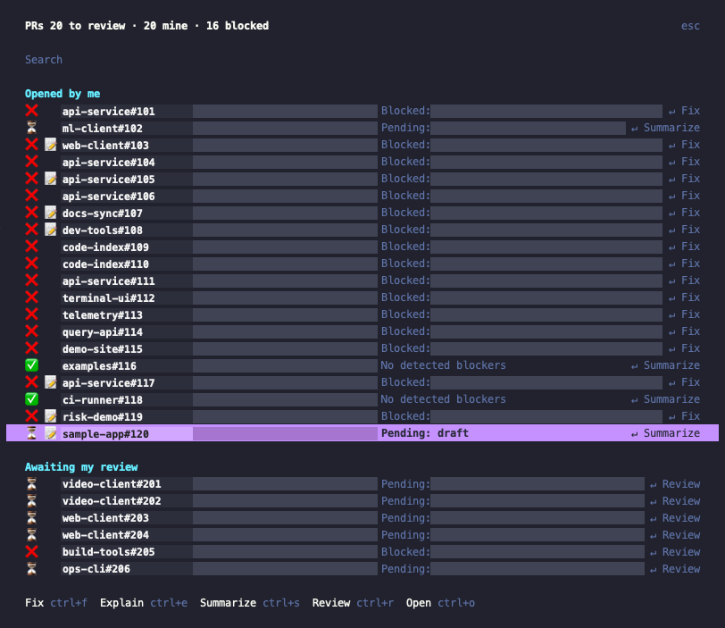
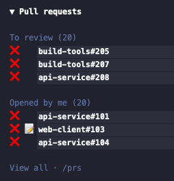

# OpenCode Pull Requests

Track GitHub PRs, see what needs attention, and start dedicated OpenCode sessions to review, summarize, investigate or fix them.

An OpenCode v2 terminal plugin. Uses your existing GitHub CLI authentication; no separate token setup.

## Features

- **Personal inbox:** open PRs requesting your review, assigned to you, or opened by you.
- **Status at a glance:** coloured indicators, draft markers, failing check names and review blockers.
- **Dedicated sessions:** PR-specific prompts using your configured model (GPT-6 Luna by default).
- **Configurable inbox:** shared GitHub filters and per-group query selectors.
- **Sidebar access:** collapsible section with counts and clickable PR previews.
- **Fast opening:** cached results appear immediately while fresh data loads in the background.
- **Notifications:** a toast when one of your PRs becomes newly blocked.

## Screenshots

### PR list



### Session sidebar



Repository names and PR numbers are fictional examples. PR titles and detailed blocker text are masked; unrelated background and sidebar content are cropped out.

## Setup

Requirements:

- OpenCode v2 **2.0.26 or newer**, using the terminal UI.
- [GitHub CLI](https://cli.github.com/) (`gh`) installed and authenticated with access to your repositories.
- Access to your configured session model (`github-copilot/gpt-6-luna` by default).
- Bun for installing dependencies in a local checkout.

If needed, sign in to GitHub:

```sh
gh auth login
```

### Local checkout

Run `bun install` in this repository. Its `opencode.jsonc` enables the plugin locally:

```jsonc
{
  "$schema": "https://opencode.ai/config.json",
  "plugins": ["./"],
}
```

For use across projects, add the checkout's absolute path to the existing `plugins` array in `~/.config/opencode/cli.json`:

```json
{
  "plugins": ["/absolute/path/to/opencode-plugin-pull-requests"]
}
```

Preserve your other settings and plugin entries. Reopen the TUI if the plugin does not reload automatically.

### GitHub installation

Once published to GitHub, install using the actual repository owner and name:

```sh
opencode plugin add github:OWNER/REPO
```

See [OpenCode's plugin documentation](https://opencode.ai/v2/docs/plugins/) for version pinning and updates.

## Configuration

Replace the plugin's string entry with an object containing `package` and `options`. Configure it where you already load it: `~/.config/opencode/cli.json` for terminal-only loading, or `opencode.json(c)` for server/project loading. Avoid adding duplicate entries in both files.

```json
{
  "plugins": [
    {
      "package": "/absolute/path/to/opencode-plugin-pull-requests",
      "options": {
        "model": "github-copilot/gpt-6-luna",
        "query": "org:example-org"
      }
    }
  ]
}
```

| Option | Default | Meaning |
| --- | --- | --- |
| `model` | `github-copilot/gpt-6-luna` | Session model in `provider/model` or `provider/model#variant` format |
| `query` | Empty | Shared GitHub search filters appended to every group |
| `queries.review` | `review-requested:@me` | Replacement selector for the review-request group |
| `queries.assigned` | `assignee:@me -author:@me` | Replacement selector for assignments |
| `queries.authored` | `author:@me` | Replacement selector for authored PRs |

The common base is `is:pr is:open archived:false sort:updated-desc`. Each final search is **base + group selector + shared query**. Group overrides replace only the selector; they retain the base and shared filters. Use GitHub search syntax, not GraphQL.

Shared filter examples:

```text
org:example-org
repo:example-org/api-service
org:example-org -is:draft
org:example-org label:"needs attention"
```

For team review requests or different group criteria:

```json
{
  "model": "github-copilot/gpt-6-luna#high",
  "query": "org:example-org",
  "queries": {
    "review": "team-review-requested:example-org/reviewers",
    "authored": "author:@me -is:draft"
  }
}
```

Put these fields inside `options`. Omitted groups retain their defaults. Options are validated on load; misspelled keys, malformed model identifiers and empty group selectors are rejected. Model availability and GitHub query semantics are validated by their respective services.

Changes apply when OpenCode reloads the plugin; reopen the TUI if necessary. New sessions use the configured model; existing sessions and your global model default are unchanged. Caches are scoped by the final queries, so changing filters does not briefly display results from another scope. Keep personal organization filters in your user config, not the repository.

## PR list

Run **`/prs`**, or select **Pull requests** from the command palette (`Ctrl+P`).

The list groups PRs into **Opened by me** and **Awaiting my review**. The review group also includes PRs assigned to you. Only open PRs in non-archived repositories are tracked. Duplicates appear once, with your own PRs placed in the authored group.

Each row shows:

- Status and optional draft icon.
- Repository name, PR number and title; owner prefixes are omitted for space.
- Aligned status reasons, including failing check names.
- The action Enter will run: **↵ Review**, **↵ Fix** or **↵ Summarize**.

Use the search field to filter the list. Long titles are truncated with `…`. The popup uses OpenCode's widest size (`xlarge`), capped at 116 terminal columns and constrained by your terminal width.

### Status indicators

| Indicator | State                | Meaning                                                                          |
| --------- | -------------------- | -------------------------------------------------------------------------------- |
| ❌        | Blocked              | Failing checks, merge conflicts, changes requested, or unresolved review threads |
| ⏳        | Pending              | Checks running, review required, or draft status                                 |
| ✅        | No detected blockers | None of the tracked blockers are present                                         |
| 📝        | Draft                | A second icon, independent of the overall status                                 |

Draft alone is pending, not blocked. A draft with failing checks or other actionable blockers remains red:

```text
⏳ 📝 repo#123   Draft awaiting review
❌ 📝 repo#124   Draft with failing checks
✅    repo#125   No detected blockers
```

Non-draft rows reserve the draft icon's space so names align. The picker uses coloured emoji; sidebar indicators also use red/green theme colours and yellow for pending. Outdated or resolved review threads do not count as unresolved blockers.

**No detected blockers is not a guarantee that GitHub will allow merging.** See the limits below.

### Actions

| Shortcut | Action    | What the new session is asked to do                                               |
| -------- | --------- | --------------------------------------------------------------------------------- |
| `Enter`  | Default   | Review someone else's PR; fix your blocked PR; otherwise summarize                |
| `Ctrl+F` | Fix       | Inspect failures, review threads and conflicts; make minimal fixes, test and push |
| `Ctrl+E` | Explain   | Investigate blockers and recommend next steps without changing code               |
| `Ctrl+S` | Summarize | Explain intent, changes, risks and discussion without changing code               |
| `Ctrl+R` | Review    | Inspect correctness, tests, security and maintainability; report findings         |
| `Ctrl+O` | Open      | Open the PR in your browser; no session is created                                |

Explicit actions override the default. Draft-only PRs default to **Summarize**, not Fix. You can also click the footer actions.

### Session behaviour

Every analysis or fix action creates a **new session** and navigates to it. Sessions:

- Use your configured model, defaulting to **`github-copilot/gpt-6-luna`**.
- Start at the TUI's current location; repositories are not automatically located or cloned.
- Receive the full PR URL, repository identity, author, title and observed blockers.
- Fetch further details through `gh` as needed.

The Fix prompt asks the agent to work in an isolated PR checkout, run relevant tests, avoid force-pushing over others' commits, and never merge, close or mark ready for review. Review prompts ask for findings without posting comments or submitting a review unless requested.

These are **agent instructions**, not plugin-enforced restrictions. Fix sessions can edit and push code under your OpenCode permissions. The plugin does not provision a worktree itself or autonomously maintain PRs.

## Sidebar and footer

The session sidebar has a **Pull requests** section:

- Click **▼/▶** to expand or collapse the entire section. This survives plugin reloads, but not TUI restarts.
- Each group shows its fetched count and up to **three PRs**, prioritizing blocked, then pending, then ready. Ties retain fetched order.
- Click a PR to open `/prs` with that PR selected.
- Click a group heading or **View all · /prs** to open the full list.

The sidebar must be visible and the terminal wide enough to display it.

The home footer shows a compact summary, for example:

```text
PRs 3 to review · 5 mine · 2 blocked
```

The blocked count covers **your authored PRs**, not the review queue. Loading and unavailable states are shown separately.

## Refresh and notifications

- Fetches on plugin startup, every **five minutes**, and when `/prs` opens.
- **Refresh pull requests** in the command palette triggers a manual refresh.
- Opening the list shows cached results immediately with **loading…**; results update in place as the refresh finishes.
- Concurrent refreshes share one request. Cached results remain visible if refreshing fails; the list shows **refresh failed** and an error toast.
- Newly blocked authored PRs trigger a warning toast after the initial fetch. Existing blocked PRs do not notify on startup.
- The cache is in memory: it survives plugin reloads, not TUI restarts. Polling stops when the plugin unloads or the TUI exits.

## Current limits

- No pagination: fetches the **20 most recently updated results per query** for review requests, assignments and authored PRs. Counts describe fetched results, not your complete GitHub backlog.
- Examines up to **30 review threads** and **40 check/status contexts** per PR, using the latest head commit. Larger sets can hide blockers.
- Does not evaluate every branch protection rule, merge queue requirement or required-check policy. Unknown mergeability is not treated as a blocker.
- Polling interval and page sizes are currently fixed in the source, not configurable plugin options.
- Browser opening supports macOS (`open`) and Linux (`xdg-open`).

## Troubleshooting

- **No `/prs` command:** check the plugin path and installed dependencies, then reopen the TUI. Local-directory loading uses the root `index.ts` and `tui.tsx` entrypoints.
- **Loading or refresh failed:** check GitHub CLI authentication, repository access, API availability and rate limits. The error toast contains the fetch failure.
- **Sidebar missing:** enable the session sidebar and widen your terminal; `/prs` remains available.
- **Session creation fails:** confirm the configured model and optional variant are available through your provider.
- **Sandbox denial:** check your sandbox's permissions for `gh`, filesystem access and the browser opener.

## Development

```sh
bun install
bun run typecheck
bun run test
```

Server and TUI entrypoints are exported from `package.json`; root entrypoints support local-directory loading. Tracking and UI behaviour currently run in the terminal plugin.
